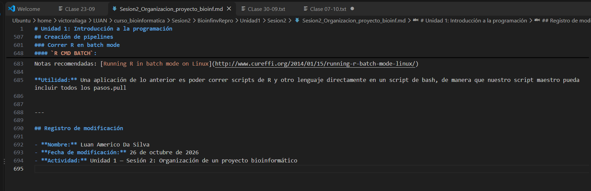
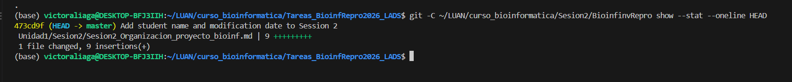
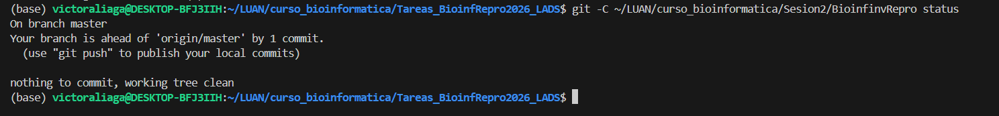

# Unit 1 — Session 2: Organization of a Bioinformatics Project

**Student:** Luan Americo Da Silva  
**Program:** Doctoral Program in Biomedical Sciences, University of Chile  
**Course:** Reproducible Bioinformatics  
**Date:** October 26, 2026

## 1. Objective

Document the modification of the Session 2 page in the course repository and record the changes using Git.

## 2. Document Modification

The file `Sesion2_Organizacion_proyecto_bioinf.md` was modified in a local clone of the course repository. A modification record was added with the student's name, modification date, and activity title.

## 3. Evidence

### Evidence 1. Modified Markdown Document

The screenshot shows the modification record added to the Session 2 Markdown document.

### Evidence 2. Git Commit

The modification was recorded in the following local commit:

- **Commit:** `473cd9f`
- **Commit message:** `Add student name and modification date to Session 2`
- **Change:** 9 lines added to the Markdown document.

### Evidence 3. Final Git Status

The screenshot documents the final status of the course repository. The working tree is clean, and the local branch contains one commit not pushed to the course remote.

## 4. Reproducibility

The course repository was cloned using the `master` branch and the `--single-branch` option. The Markdown changes were reviewed with `git diff --check` and recorded in a local Git commit.

The commit remains local to avoid pushing changes to the shared course repository. The evidence and documentation are maintained in this personal assignment repository.

## 5. Conclusion

This exercise provided practice in editing Markdown documentation, reviewing changes with Git, recording versions through commits, and organizing evidence for a reproducible assignment.
