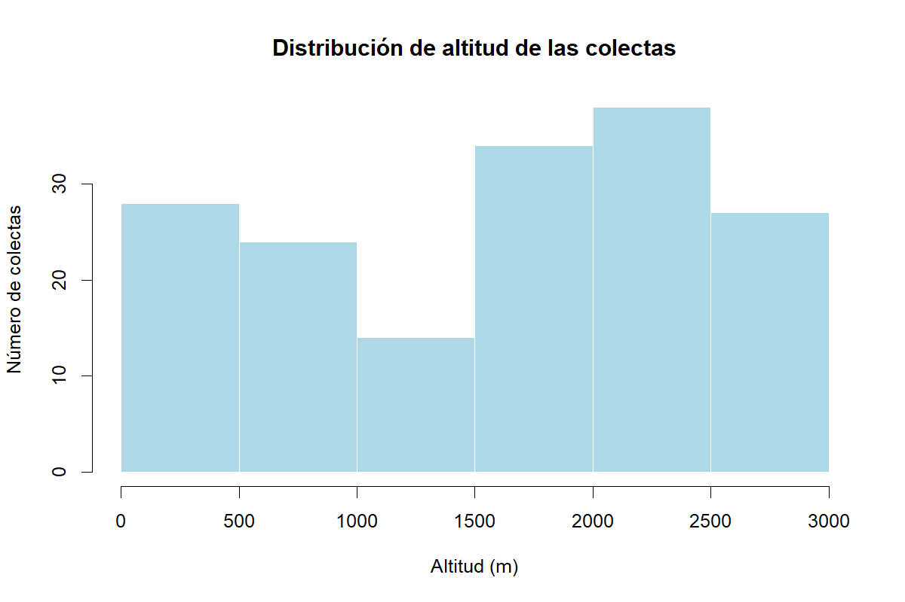
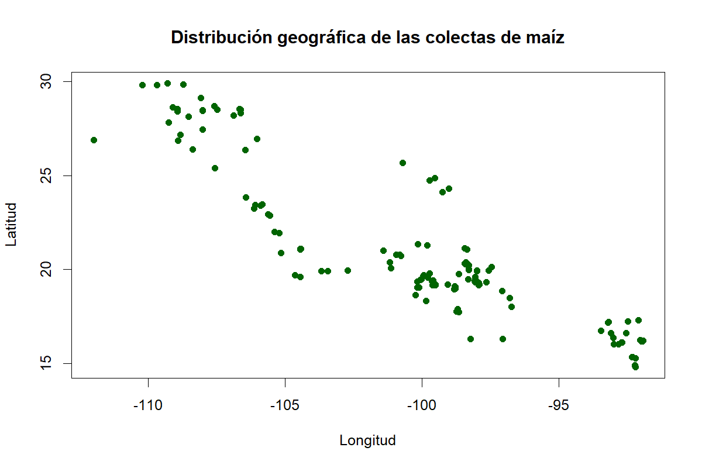

# Reproducible Bioinformatics — Session 1.3

## Overview

This folder contains scripts and notes for the R programming and data-analysis exercises completed during Session 1.3 of the Reproducible Bioinformatics course.

The activities cover basic R operations, loops, data import, data exploration, genetic differentiation, and isolation-by-resistance analyses.

## Exercises

### Exercise 1 — Variables and logarithms

Introduces variables and logarithmic operations in R.

[View script](scripts/ejercicio1.R)

### Exercise 2 — Adding 2 to numbers from 1 to 150

Practices numerical sequences and applying an arithmetic operation to a range of values.

[View script](scripts/ejercicio2.R)

### Exercise 3 — Counting numbers greater than 20

Practices conditional evaluation and counting values that satisfy a numerical condition.

[View script](scripts/ejercicio3.R)

### Exercise 4 — Importing maize metadata

Checks whether the input file exists, imports the maize metadata table from the course environment, and inspects the resulting dataset.

[View script](scripts/ejercicio4.R)

### Exercise 5 — Loops and division

Uses a `for` loop to divide 35 by the integers from 1 to 10. The exercise then uses `next` to skip even divisors and stores the results for odd divisors in a data frame.

The documented odd-divisor results are: 35/1 = 35, 35/3 ≈ 11.67, 35/5 = 7, 35/7 = 5, and 35/9 ≈ 3.89.

[View script](scripts/ejercicio5.R)

### Exercise 6 — Isolation by resistance

The available notes describe an analysis of 13 resistance scenarios. Effective-distance matrices are compared with transformed genetic differentiation values using `B.Fst / (1 - B.Fst)`. Mantel correlation coefficients and p-values are collected to compare the association across scenarios.

The current repository contains the explanatory notes, but the corresponding executable exercise script has not yet been confirmed in this folder.

[View exercise notes](ejercicio6.md)

### Exercise 7 — Function test

Tests a function from the exercise. The recorded output was 0.04.

[View script](scripts/ejercicio7.R)

### Exercise 8 — Partial Mantel tests

Performs partial Mantel tests for the present and the Last Glacial Maximum (LGM, approximately 1800 in the exercise data), controlling for the flat-distance matrix.

The recorded results were:

- Present: r = 0.05878, p = 0.44722.
- LGM: r = 0.2437, p = 0.27083.

Neither test was statistically significant at the 0.05 significance level. These results do not provide sufficient evidence of an association under the tested models; they do not prove that no relationship exists.

[View script](scripts/ejercicio8.R)

### Exercise 9 — Exploring maize collection metadata

Imports and explores the maize collection metadata, checks its dimensions, variable names, missing values and data types, and summarizes the collection altitudes and collection years.

The dataset was loaded with 165 observations and 22 variables. The script also generated a histogram of collection altitudes and a scatter plot of the geographic coordinates.

#### Altitude distribution

#### Geographic distribution

[View script](scripts/ejercicio9.R)

## Reproducibility notes

- Scripts are stored in the `scripts/` directory.
- Figures generated for Exercise 9 are stored in `figures/` and embedded above using relative paths.
- Some input data and helper scripts remain in the course-material directory rather than in this repository. File paths may therefore need to be adjusted when running the scripts on another computer.
- The Exercise 9 import produced character-encoding warnings. Although the dataset loaded and the figures were generated, text fields should be checked for encoding issues before further analysis.
- Exercise 10 is not included in this report.
