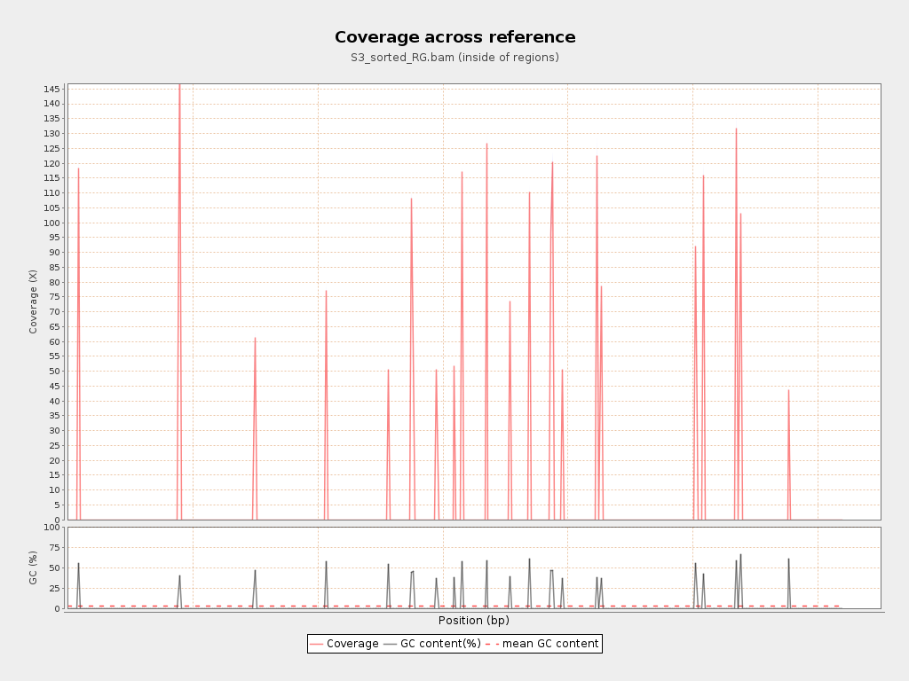

# Unit 3 – Session 1: NGS Read Filtering, Alignment, and Quality Assessment

**Author:** Luan Americo Da Silva  
**Program:** Doctoral Program in Biomedical Sciences  
**Institution:** University of Chile  
**Course:** Reproducible Bioinformatics  
**Date:** November 19, 2026

## 1. Objective

To process paired-end reads from sample S3 through adapter and contaminant removal, quality filtering, alignment against the human hg19 reference genome, and alignment quality assessment using Qualimap.

## 2. Tools

- **BBMap/BBDuk 38.90:** adapter, PhiX, and low-quality read filtering.
- **BWA 0.7.17:** alignment against hg19.
- **Picard 2.25.2:** SAM-to-BAM conversion, sorting, and read group assignment.
- **Samtools 1.12:** BAM indexing.
- **Qualimap 2.2.1:** assessment of coverage, mapping quality, and other alignment parameters.
- **Reference genome:** hg19.
- **Regions of interest:** `regiones_blanco.bed`.

## 3. Methods

### 3.1. Read filtering

BBDuk was used to remove adapters, PhiX contaminants, and low-quality bases, reducing potential interference during the alignment process.

**Adapter removal:**

```bash
bbduk.sh -Xmx2g threads=1 \
in1=~/181004_curso_calidad_datos_NGS/fastq_raw/S3_R1.fastq.gz \
in2=~/181004_curso_calidad_datos_NGS/fastq_raw/S3_R2.fastq.gz \
out1=S3_R1_filter1.fastq.gz \
out2=S3_R2_filter1.fastq.gz \
ref=~/resources/bbmap/adapters.fa tpe tbo
```

A total of 63,682 reads were retained (75.95%).

**PhiX removal:**

```bash
bbduk.sh -Xmx2g threads=1 \
in1=S3_R1_filter1.fastq.gz \
in2=S3_R2_filter1.fastq.gz \
out1=S3_R1_filter2.fastq.gz \
out2=S3_R2_filter2.fastq.gz \
ref=~/resources/bbmap/phix174_ill.ref.fa.gz
```

Eight reads were removed, leaving 63,674 reads (99.99% of the previous stage).

**Quality filtering:**

```bash
bbduk.sh -Xmx2g threads=1 \
in1=S3_R1_filter2.fastq.gz \
in2=S3_R2_filter2.fastq.gz \
out1=S3_R1_filter3.fastq.gz \
out2=S3_R2_filter3.fastq.gz \
qtrim=w trimq=20 minlength=30 minavgquality=20
```

Quality trimming (Q20), a minimum read length of 30 nucleotides, and a minimum average quality of Q20 were applied. A total of 62,270 reads were retained (97.80% of the reads entering this stage).

### 3.2. Alignment

BWA-MEM was used to align the filtered reads against hg19. Four threads (`-t 4`) were used, together with the `-M` option to mark shorter split hits as secondary alignments, maintaining compatibility with downstream tools.

```bash
bwa mem -t 4 -M /datos/reference/genomes/hg19_reference/hg19.fasta \
S3_R1_filter3.fastq.gz \
S3_R2_filter3.fastq.gz \
> S3.sam
```

### 3.3. BAM file preparation

The SAM file was converted to BAM, a more compact binary format for storing alignment information.

```bash
java -jar /opt/picard/picard-2.25.2/picard.jar SamFormatConverter -I S3.sam -O S3.bam
```

The reads were then sorted by genomic coordinates to facilitate access to and analysis of specific genomic regions.

```bash
java -jar /opt/picard/picard-2.25.2/picard.jar SortSam I=S3.bam O=S3_sorted.bam SORT_ORDER=coordinate
```

Read groups were added as metadata to identify the sequencing library and maintain compatibility with downstream analysis tools.

```bash
java -jar /opt/picard/picard-2.25.2/picard.jar AddOrReplaceReadGroups \
-I S3_sorted.bam -O S3_sorted_RG.bam \
-ID sample -LB Paired-end -PL Illumina -PU Unknown -SM sample
```

Finally, the BAM file was indexed using Samtools, generating a BAI file that enables rapid access to specific genomic regions.

```bash
samtools index S3_sorted_RG.bam
```

### 3.4. Qualimap assessment

Qualimap BAM QC was used to assess coverage, mapping quality, insert size, estimated duplication, and read clipping, using the BED file containing the target regions.

```bash
JAVA_OPTS="-Xms32m -Xmx1200M" qualimap bamqc \
-bam S3_sorted_RG.bam \
-gff ~/181004_curso_calidad_datos_NGS/regiones_blanco.bed \
-outdir ./S3_sorted_RG
```

**Technical issue and solution:** The initial execution failed because of an incompatibility with the Java option `-XX:MaxPermSize=1024m` (`Unrecognized VM option`). The issue was resolved by temporarily overriding the Java options through `JAVA_OPTS` and setting the maximum memory allocation to 1200 MB (`-Xmx1200M`). This approach did not require modifying the software installation or the server's permanent configuration. Qualimap then completed successfully and generated the HTML report and BAM QC results.

## 4. Results

### 4.1. Alignment

Qualimap reported 62,347 read records, of which 62,323 were mapped (99.96%). The mean mapping quality (MAPQ) was 58.74, indicating high overall confidence in read assignment.

### 4.2. Coverage

Mean coverage was 101.28X, with a standard deviation of 99.57X. A total of 91.44% of the evaluated positions reached ≥1X coverage, 72.49% reached ≥30X, and 63.11% reached ≥50X.

The standard deviation, which was close to the mean, indicates a heterogeneous coverage distribution.

### 4.3. Insert size

The median insert size was 247 bp, the mean was 251.66 bp, and the standard deviation was 40.04 bp. The distribution was mainly concentrated around these values, with a tail of larger fragments.

### 4.4. Errors and duplication

The estimated overall error rate was 0.27%. The analysis identified 23,142 mismatches, 1,174 insertions, and 1,709 deletions.

Estimated duplication was 38.12%, an important parameter for evaluating library complexity and read redundancy.

### 4.5. Soft clipping

A read with the CIGAR string `2S100M` was identified in the SAM file. This indicates two soft-clipped nucleotides and 100 aligned nucleotides. Soft-clipped bases remain in the read sequence but are not included in the alignment. This may reflect differences from the reference sequence or other features at the read ends.

## 5. Figures

**Figure 1. Coverage across the reference.** Sequencing depth distribution, showing heterogeneous coverage and less-represented regions.



**Figure 2. Mapping quality (MAPQ).** Distribution of mapping quality values assigned to aligned reads, used to assess alignment confidence.


**Figure 3. Insert size.** Distribution of estimated distances between paired-end reads, used to characterize sequenced fragments and identify outliers.


**Figure 4. Read clipping profile.** Distribution of read ends not incorporated into the alignment, allowing identification of positions where clipping is concentrated.


## 6. Discussion

The high proportion of mapped reads (99.96%) and mean MAPQ of 58.74 indicate that most reads were assigned to the reference with high confidence. However, successful alignment does not guarantee uniform coverage: the standard deviation (99.57X) was nearly equivalent to the mean (101.28X), demonstrating a heterogeneous depth distribution.

This means that some regions may be highly represented while others have insufficient coverage, potentially affecting variant detection and the interpretation of results in specific regions.

The estimated duplication rate of 38.12% suggests a considerable proportion of redundant reads, which could reduce the effective library diversity and cause apparent sequencing depth to overestimate the amount of independent information available. Nevertheless, Qualimap provides an estimate, and duplicate removal was not performed; therefore, it cannot be concluded that all these reads correspond to PCR duplicates.

Soft clipping reflects the presence of bases that could not be incorporated into the alignment. Possible causes include differences from the reference, low-quality bases at read ends, residual adapters, or other read characteristics. The identification of `2S100M` demonstrates this phenomenon, although a single read is insufficient to determine its underlying cause.

Coverage interpretation must consider the targeted nature of the analysis and the regions included in the BED file. The absence of coverage in regions outside the sequencing targets does not necessarily indicate a technical problem. Therefore, coverage should be evaluated within the regions of interest rather than extrapolated to the entire genome.

## 7. Conclusions

Sample S3 processing enabled read filtering, contaminant removal, alignment against hg19, and BAM file quality assessment using Qualimap.

A high proportion of reads mapped successfully (99.96%), with a high mean mapping quality (58.74). However, coverage was heterogeneous, with a standard deviation close to the mean and 72.49% of evaluated positions reaching at least 30X coverage.

Overall, the results indicate high global alignment quality, although sequencing depth was not uniform and estimated duplication was considerable. These parameters should be considered in downstream analyses, prioritizing coverage within the regions of interest and the quality of the available independent information.

## 8. Supplementary materials

The complete Qualimap report is included in this repository, comprising the HTML report, summary results, raw numerical data, and complementary figures.

To view the complete interactive report, open `resultados_qualimap/qualimapReport.html` in a web browser. The associated CSS, JavaScript, and image resources are included in the same directory structure.