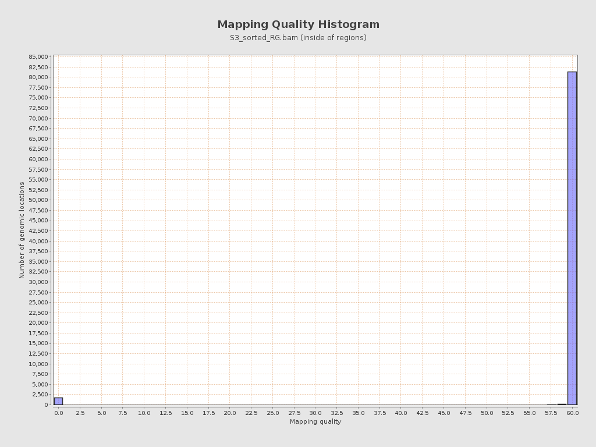
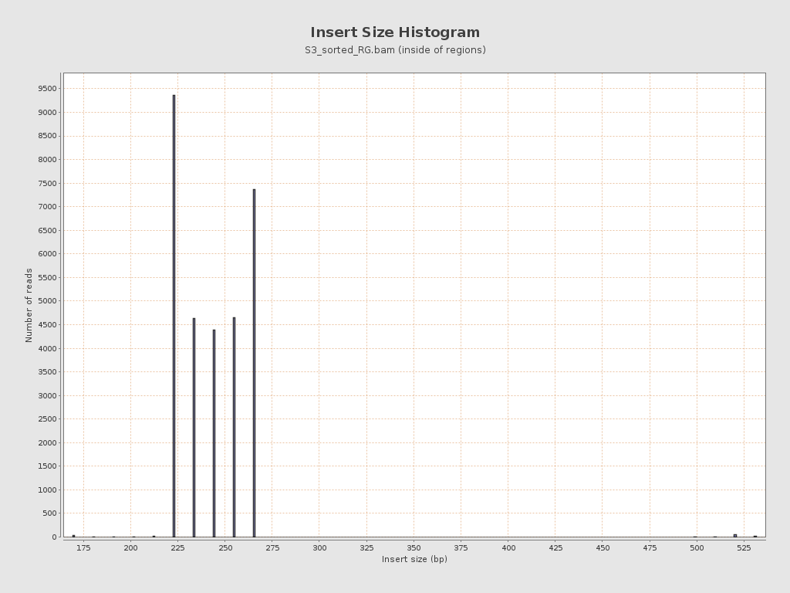
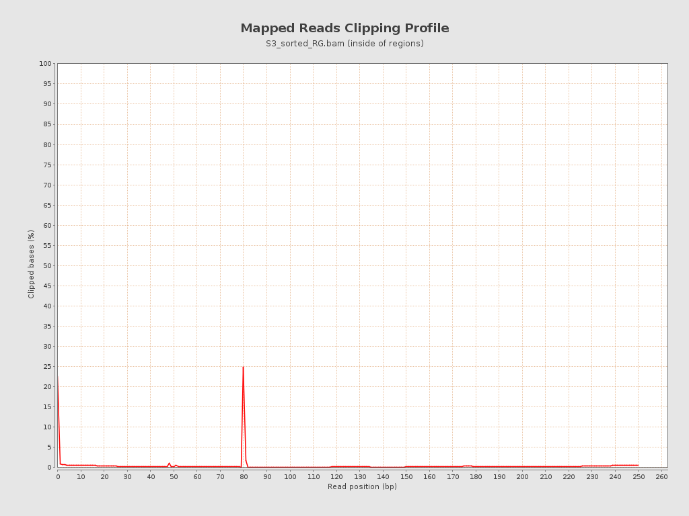

# Unit 3 – Session 1: NGS Read Filtering, Alignment, and Quality Assessment

**Author:** Luan Americo Da Silva  
**Program:** Doctoral Program in Biomedical Sciences  
**Institution:** University of Chile  
**Course:** Reproducible Bioinformatics  
**Date:** November 19, 2026

## 1. Objective

To process paired-end reads from sample S3 through adapter and contaminant removal, quality filtering, alignment against the human hg19 reference genome, and alignment quality assessment using Qualimap.

## 2. Tools

- **BBMap/BBDuk 38.90:** adapter, PhiX, and low-quality read filtering.
- **BWA 0.7.17:** alignment against hg19.
- **Picard 2.25.2:** SAM-to-BAM conversion, sorting, and read group assignment.
- **Samtools 1.12:** BAM indexing.
- **Qualimap 2.2.1:** assessment of coverage, mapping quality, and other alignment parameters.
- **Reference genome:** hg19.
- **Regions of interest:** `regiones_blanco.bed`.

## 3. Methods

### 3.1. Read filtering

BBDuk was used to remove adapters, PhiX contaminants, and low-quality bases, reducing potential interference during the alignment process.

**Adapter removal:**

```bash
bbduk.sh -Xmx2g threads=1 \
in1=~/181004_curso_calidad_datos_NGS/fastq_raw/S3_R1.fastq.gz \
in2=~/181004_curso_calidad_datos_NGS/fastq_raw/S3_R2.fastq.gz \
out1=S3_R1_filter1.fastq.gz \
out2=S3_R2_filter1.fastq.gz \
ref=~/resources/bbmap/adapters.fa tpe tbo
```

A total of 63,682 reads were retained (75.95%).

**PhiX removal:**

```bash
bbduk.sh -Xmx2g threads=1 \
in1=S3_R1_filter1.fastq.gz \
in2=S3_R2_filter1.fastq.gz \
out1=S3_R1_filter2.fastq.gz \
out2=S3_R2_filter2.fastq.gz \
ref=~/resources/bbmap/phix174_ill.ref.fa.gz
```

Eight reads were removed, leaving 63,674 reads (99.99% of the previous stage).

**Quality filtering:**

```bash
bbduk.sh -Xmx2g threads=1 \
in1=S3_R1_filter2.fastq.gz \
in2=S3_R2_filter2.fastq.gz \
out1=S3_R1_filter3.fastq.gz \
out2=S3_R2_filter3.fastq.gz \
qtrim=w trimq=20 minlength=30 minavgquality=20
```

Quality trimming (Q20), a minimum read length of 30 nucleotides, and a minimum average quality of Q20 were applied. A total of 62,270 reads were retained (97.80% of the reads entering this stage).

### 3.2. Alignment

BWA-MEM was used to align the filtered reads against hg19. Four threads (`-t 4`) were used, together with the `-M` option to mark shorter split hits as secondary alignments, maintaining compatibility with downstream tools.

```bash
bwa mem -t 4 -M /datos/reference/genomes/hg19_reference/hg19.fasta \
S3_R1_filter3.fastq.gz \
S3_R2_filter3.fastq.gz \
> S3.sam
```

### 3.3. BAM file preparation

The SAM file was converted to BAM, a more compact binary format for storing alignment information.

```bash
java -jar /opt/picard/picard-2.25.2/picard.jar SamFormatConverter -I S3.sam -O S3.bam
```

The reads were then sorted by genomic coordinates to facilitate access to and analysis of specific genomic regions.

```bash
java -jar /opt/picard/picard-2.25.2/picard.jar SortSam I=S3.bam O=S3_sorted.bam SORT_ORDER=coordinate
```

Read groups were added as metadata to identify the sequencing library and maintain compatibility with downstream analysis tools.

```bash
java -jar /opt/picard/picard-2.25.2/picard.jar AddOrReplaceReadGroups \
-I S3_sorted.bam -O S3_sorted_RG.bam \
-ID sample -LB Paired-end -PL Illumina -PU Unknown -SM sample
```

Finally, the BAM file was indexed using Samtools, generating a BAI file that enables rapid access to specific genomic regions.

```bash
samtools index S3_sorted_RG.bam
```

### 3.4. Qualimap assessment

Qualimap BAM QC was used to assess coverage, mapping quality, insert size, estimated duplication, and read clipping, using the BED file containing the target regions.

```bash
JAVA_OPTS="-Xms32m -Xmx1200M" qualimap bamqc \
-bam S3_sorted_RG.bam \
-gff ~/181004_curso_calidad_datos_NGS/regiones_blanco.bed \
-outdir ./S3_sorted_RG
```

**Technical issue and solution:** The initial execution failed because of an incompatibility with the Java option `-XX:MaxPermSize=1024m` (`Unrecognized VM option`). The issue was resolved by temporarily overriding the Java options through `JAVA_OPTS` and setting the maximum memory allocation to 1200 MB (`-Xmx1200M`). This approach did not require modifying the software installation or the server's permanent configuration. Qualimap then completed successfully and generated the HTML report and BAM QC results.

## 4. Results

### 4.1. Alignment

Qualimap reported 62,347 read records, of which 62,323 were mapped (99.96%). The mean mapping quality (MAPQ) was 58.74, indicating high overall confidence in read assignment.

### 4.2. Coverage

Mean coverage was 101.28X, with a standard deviation of 99.57X. A total of 91.44% of the evaluated positions reached ≥1X coverage, 72.49% reached ≥30X, and 63.11% reached ≥50X.

The standard deviation, which was close to the mean, indicates a heterogeneous coverage distribution.

### 4.3. Insert size

The median insert size was 247 bp, the mean was 251.66 bp, and the standard deviation was 40.04 bp. The distribution was mainly concentrated around these values, with a tail of larger fragments.

### 4.4. Errors and duplication

The estimated overall error rate was 0.27%. The analysis identified 23,142 mismatches, 1,174 insertions, and 1,709 deletions.

Estimated duplication was 38.12%, an important parameter for evaluating library complexity and read redundancy.

### 4.5. Soft clipping

A read with the CIGAR string `2S100M` was identified in the SAM file. This indicates two soft-clipped nucleotides and 100 aligned nucleotides. Soft-clipped bases remain in the read sequence but are not included in the alignment. This may reflect differences from the reference sequence or other features at the read ends.

## 5. Figures

**Figure 1. Coverage across the reference.** Sequencing depth distribution, showing heterogeneous coverage and less-represented regions.


**Figure 2. Mapping quality (MAPQ).** Distribution of mapping quality values assigned to aligned reads, used to assess alignment confidence.



**Figure 3. Insert size.** Distribution of estimated distances between paired-end reads, used to characterize sequenced fragments and identify outliers.



**Figure 4. Read clipping profile.** Distribution of read ends not incorporated into the alignment, allowing identification of positions where clipping is concentrated.



## 6. Discussion

The high proportion of mapped reads (99.96%) and mean MAPQ of 58.74 indicate that most reads were assigned to the reference with high confidence. However, successful alignment does not guarantee uniform coverage: the standard deviation (99.57X) was nearly equivalent to the mean (101.28X), demonstrating a heterogeneous depth distribution.

This means that some regions may be highly represented while others have insufficient coverage, potentially affecting variant detection and the interpretation of results in specific regions.

The estimated duplication rate of 38.12% suggests a considerable proportion of redundant reads, which could reduce the effective library diversity and cause apparent sequencing depth to overestimate the amount of independent information available. Nevertheless, Qualimap provides an estimate, and duplicate removal was not performed; therefore, it cannot be concluded that all these reads correspond to PCR duplicates.

Soft clipping reflects the presence of bases that could not be incorporated into the alignment. Possible causes include differences from the reference, low-quality bases at read ends, residual adapters, or other read characteristics. The identification of `2S100M` demonstrates this phenomenon, although a single read is insufficient to determine its underlying cause.

Coverage interpretation must consider the targeted nature of the analysis and the regions included in the BED file. The absence of coverage in regions outside the sequencing targets does not necessarily indicate a technical problem. Therefore, coverage should be evaluated within the regions of interest rather than extrapolated to the entire genome.

## 7. Conclusions

Sample S3 processing enabled read filtering, contaminant removal, alignment against hg19, and BAM file quality assessment using Qualimap.

A high proportion of reads mapped successfully (99.96%), with a high mean mapping quality (58.74). However, coverage was heterogeneous, with a standard deviation close to the mean and 72.49% of evaluated positions reaching at least 30X coverage.

Overall, the results indicate high global alignment quality, although sequencing depth was not uniform and estimated duplication was considerable. These parameters should be considered in downstream analyses, prioritizing coverage within the regions of interest and the quality of the available independent information.

## 8. Supplementary materials

The complete Qualimap report is included in this repository, comprising the HTML report, summary results, raw numerical data, and complementary figures.

To view the complete interactive report, open `resultados_qualimap/qualimapReport.html` in a web browser. The associated CSS, JavaScript, and image resources are included in the same directory structure.


# Unit 3 – Session 1: Part 2 – Variant Identification, Annotation, and Prioritization

**Author:** Luan Americo Da Silva  
**Program:** Doctoral Program in Biomedical Sciences  
**Institution:** University of Chile  
**Course:** Reproducible Bioinformatics  
**Date:** November 21, 2026

## 9. Objective

To identify genetic variants in sample S3 from the sequencing data previously aligned to the hg19 reference genome. Subsequently, to characterize their potential functional consequences through annotation with the Ensembl Variant Effect Predictor (VEP), prioritize candidate variants using CADD and ClinVar information, and visually inspect selected variants using the Integrative Genomics Viewer (IGV).

## 10. Tools and Resources

- **Samtools:** inspection and manipulation of BAM alignment files.
- **VCFtools and command-line tools (Bash, awk, grep):** inspection, filtering, and processing of VCF files.
- **Ensembl Variant Effect Predictor (VEP):** functional annotation of variants and retrieval of transcript consequences, HGVS nomenclature, CADD scores, and ClinVar information.
- **Integrative Genomics Viewer (IGV):** visualization of aligned reads and variants in their genomic context.
- **Reference genome:** GRCh37/hg19.
- **Main input files:** S3 BAM alignment file, its BAI index, and the variant VCF file.

## 11. Methods

### 11.1. Variant inspection and identification

The S3 VCF file was used to examine the variants identified during the sequencing analysis. Initially, its contents were inspected and the total number of records was counted.

```bash
grep -v '^#' S3_variants.vcf | wc -l
```

This command counts variant records while excluding VCF metadata and header lines.

To inspect the first variant records and their annotations, the following command was used:

```bash
grep -v '^#' S3_variants.vcf | head
```

The file contained 116 variants, comprising 83 SNPs and 33 INDELs.

### 11.2. Variant filtering

Variant quality criteria were examined, mainly considering read depth (DP) and quality by depth (QD).

DP thresholds of 10, 20, and 30 were evaluated, together with a QD threshold of 2. The DP10/QD2 criteria were used to generate filtered SNP and INDEL files. These parameters help exclude variants with insufficient read support or lower relative quality.

The DP20 and DP30 thresholds were also explored as comparative filtering conditions to assess the effect of more stringent read-depth requirements. The corresponding filtering results showed that increasing the DP threshold reduced the number of retained variants.

The filtered files were kept separate according to variant type to facilitate subsequent inspection and analysis.

### 11.3. Functional annotation using VEP

The original VCF file was submitted to the Ensembl Variant Effect Predictor (VEP), using the GRCh37.p13 human genome assembly, which is compatible with hg19.

The annotation options were configured to retrieve:

- Functional consequences for each transcript.
- HGVS nomenclature at the coding DNA and protein levels.
- CADD scores.
- Available phenotype associations.
- Clinical significance information from ClinVar.

The results were downloaded in VCF and TSV formats. The TSV file was primarily used to inspect the annotations and compare the consequences associated with each variant.

Because a variant can affect multiple transcripts from the same gene, the VEP output may contain several rows for a single genomic coordinate. Therefore, unique genomic variants were considered in subsequent analyses to avoid counting each transcript consequence as an independent variant.

### 11.4. Variant processing and prioritization

The VEP TSV file was processed using Bash and AWK tools to extract relevant information, group annotations by variant, and generate a summary table.

An exploratory prioritization criterion was applied:

**ClinVar classification other than `Benign` OR CADD_PHRED > 20.**

This criterion selected variants with ClinVar classifications other than exactly `Benign` or CADD scores greater than 20. Variants without ClinVar information were considered unclassified, rather than automatically considered non-benign.

A summary table was generated containing the gene, genomic coordinate, reference and alternative alleles, main consequence, protein HGVS, CADD score, and ClinVar classification.

### 11.5. Variant visualization using IGV

IGV was used to examine selected variants in their genomic context. The S3 BAM file, its BAI index, and the variant VCF file were loaded using hg19 as the reference genome.

The visualization allowed inspection of the reads supporting the variants, allele distribution, and correspondence with the positions reported in the VCF file.

Particular attention was given to the BRCA2 variant at chr13:32914935 because of its frameshift consequence and Pathogenic classification in ClinVar.

## 12. Results and Tutorial Analysis

### 12.1. How many variants were identified in sample S3?

The VCF file contained 116 variants, of which 83 were SNPs and 33 were INDELs.

This distinction allowed the initial characterization of the identified variants. SNPs represent single-nucleotide substitutions, whereas INDELs correspond to insertions or deletions of one or more nucleotides.

Both variant types were considered in the subsequent analysis because they can have different functional consequences depending on their genomic location and transcript context.

### 12.2. What functional information does VEP annotation provide?

VEP annotation generated 579 records corresponding to the transcript-level consequences of 116 unique variants.

The difference between the number of records and the number of variants is explained by the fact that a single genomic position can affect different transcripts and therefore have more than one functional consequence.

The annotations included intronic variants, changes in regions near splice sites, missense variants, frameshift variants, in-frame insertions, and variants located upstream or downstream of genes.

This information made it possible to move from the identification of genomic changes toward an initial interpretation of their potential effects on genes and proteins.

### 12.3. What information do ClinVar and CADD provide?

ClinVar information was available for 78 of the 116 variants, whereas 38 variants had no associated classification in the VEP output. The clinical information was retrieved from the `ClinVar_CLNSIG` column in the VEP TSV file (`S3_variants_2026-11-21-07-06_VEP.tsv.gz`).

Among the variants with ClinVar information, the following classifications were observed:

- 71 classified as Benign.
- 5 classified as Benign/Likely benign.
- 1 with conflicting classifications of pathogenicity.
- 1 classified as Pathogenic.

CADD_PHRED scores were available for 107 variants, while 9 had no available score.

These results show that both resources provide complementary information. ClinVar gathers previously reported clinical interpretations, whereas CADD estimates the potential deleteriousness of a variant using multiple genomic features.

The absence of a ClinVar annotation does not indicate that a variant is benign or pathogenic; it means that no classification was available in the retrieved results.

### 12.4. Which variants met the prioritization criteria?

Applying the selected criterion (ClinVar classification other than `Benign` OR CADD_PHRED > 20) resulted in 12 candidate variants, equivalent to 10.3% of the total number of identified variants.

The following table summarizes the results:

| Gene | Coordinate (hg19) | REF | ALT | Main consequence | Protein HGVS | CADD | ClinVar |
|---|---|---|---|---|---|---:|---|
| BRAF | 7:140434574 | C | CA | splice_region_variant | — | 6.869 | Benign/Likely benign |
| PAX5 | 9:36882185 | A | T | intron_variant | — | 20.6 | No classification |
| PAX5 | 9:37002762 | A | G | missense_variant | p.Ser163Pro; p.Ser97Pro; p.Ser55Pro | 24.1 | No classification |
| PAX5 | 9:37034210 | A | G | upstream_gene_variant | — | 21.1 | No classification |
| PAX5 | 9:37034211 | A | T | upstream_gene_variant | — | 21.3 | No classification |
| PTEN | 10:89720633 | CT | C | splice_polypyrimidine_tract_variant | — | 1.742 | Benign/Likely benign |
| KMT2A | 11:118369265 | TA | T | intron_variant | — | 0.220 | Benign/Likely benign |
| FLT3 | 13:28624294 | G | A | missense_variant | p.Thr227Met | 21.0 | Benign |
| BRCA2 | 13:32907535 | CT | C | intron_variant | — | 0.354 | Conflicting classifications |
| BRCA2 | 13:32914935 | CTA | C | frameshift_variant | p.Ile2149Ter | — | Pathogenic |
| RB1 | 13:48954159 | CT | C | intron_variant | — | 0.795 | Benign/Likely benign |
| CEBPA-AS1; AC008738.1; CEBPA | 19:33792731 | G | GGCGGGT | inframe_insertion | p.His195_Pro196dup | 18.12 | Benign/Likely benign |

*Protein HGVS annotations are summarized by considering the distinct protein changes across transcripts. The symbol — indicates that no applicable protein annotation or score was available.*

Among the prioritized variants, the PAX5 missense variant (chr9:37002762) stands out, with a CADD_PHRED score of 24.1 and no available ClinVar classification. In contrast, the FLT3 variant (p.Thr227Met) had a CADD score of 21.0, although ClinVar classified it as Benign. This demonstrates that a high CADD score should not be interpreted as evidence of pathogenicity on its own.

### 12.5. What are the characteristics of the prioritized BRCA2 variant?

The variant located at chr13:32914935 (REF: CTA; ALT: C) was annotated by VEP as a frameshift_variant.

Its HGVS annotation was:

- **HGVS cDNA:** c.6445_6446del.
- **HGVS protein:** p.Ile2149Ter.
- **Consequence:** frameshift_variant.
- **ClinVar:** Pathogenic.
- **ClinVar review status:** reviewed_by_expert_panel.

This variant corresponds to a deletion that alters the reading frame and generates a premature termination codon.

Inspection of the original VCF record provided the following parameters:

| Parameter | Result |
|---|---:|
| Genotype | 0/1 |
| Total read depth (DP) | 228 |
| Reference allele reads | 123 |
| Alternative allele reads | 105 |
| Alternative allele frequency | 0.50 |
| Genotype quality (GQ) | 99 |

These values indicate strong read support for the identification of the variant in the sequencing data. In addition, visual inspection using IGV allowed direct examination of the aligned reads at the corresponding position.

### 12.6. Does IGV visualization support the identification of the variant?

The BRCA2 variant was selected as a representative example for visual inspection in IGV; the visualization was not performed for all 12 prioritized variants.

Inspection of the BRCA2 variant in IGV allowed the aligned reads in the corresponding genomic region to be examined, together with the support for the alleles reported in the VCF file.

The visualization was consistent with the presence of the computationally identified variant, providing an additional review of the alignment evidence.


**Figure 5.** IGV visualization of the BRCA2 frameshift variant at chr13:32914935 in the hg19 reference genome. The CTA>C variant, annotated as c.6445_6446del (p.Ile2149Ter), is shown together with the aligned sequencing reads supporting its identification in sample S3.

## 13. Discussion

The analysis integrated different stages of sequencing data processing, from variant identification to functional annotation and visual inspection.

VEP annotation expanded the information available in the VCF file, allowing variants to be associated with genes, transcripts, and potential protein-level consequences. However, the presence of multiple annotations per variant highlights the importance of considering transcript context during interpretation.

The integration of CADD and ClinVar information allowed 12 variants to be selected for further examination. A high CADD score represents a computational prediction of potential functional impact, whereas ClinVar gathers clinical classifications that may have different levels of supporting evidence and review.

The BRCA2 frameshift variant (chr13:32914935; p.Ile2149Ter) was particularly noteworthy because of its Pathogenic classification in ClinVar, supported by expert-panel review. It also presented a read depth of 228 and a genotype quality of 99, together with supporting evidence from visual inspection using IGV.

These results support the technical consistency of the variant call in the analyzed data. However, they do not independently establish whether the variant is germline or somatic, nor do they confirm a clinical condition in the sample under study.

Overall, the integration of functional annotation, computational prediction, clinical databases, and genomic visualization enables a more informed prioritization of candidate variants. Nevertheless, final interpretation requires consideration of the biological context, available evidence, and, when appropriate, additional experimental validation.

## 14. Conclusions

The analysis of sample S3 identified 116 variants and characterized them through functional annotation using VEP. The integration of CADD and ClinVar information allowed 12 candidate variants to be prioritized for further evaluation.

Among these, a BRCA2 frameshift variant stood out because of its Pathogenic classification in ClinVar and strong read support in the VCF file. Its inspection in IGV complemented the computational analysis through direct examination of the aligned reads, highlighting the importance of distinguishing computational predictions, clinical classifications, and experimental evidence.

## 15. Supplementary Materials

The files generated during this stage include:

- Original and filtered VCF files.
- VEP-annotated VCF and TSV files.
- Prioritized variant table.
- S3 BAM alignment file and its BAI index.
- Files used for variant visualization in IGV.

These resources allow the annotation, prioritization, and visualization steps described in this section to be reviewed and reproduced.
